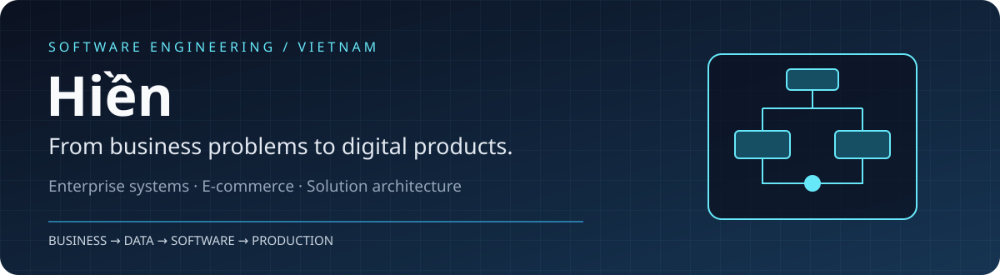

<div align="center">



**Software Engineering · Solution Architecture · Product Development**

[About](#about) · [Expertise](#expertise) · [Selected work](#selected-work) · [Engineering approach](#engineering-approach) · [Tiếng Việt](#tiếng-việt) · [Connect](#connect)

[Personal portfolio ↗](https://tranngochien89.github.io/tranngochien89/)

</div>

## About

I build software around real business needs — from the domain model and database to web, mobile and production infrastructure. My focus is enterprise applications, commerce platforms and practical digital transformation.

**Current interests:** modular business systems, reliable data models, performance engineering, and AI-assisted software delivery.

## Expertise

| Area | Focus |
| --- | --- |
| Enterprise systems | ERP, sales, inventory, purchasing, CRM, HRM, helpdesk |
| Commerce | Catalog, search, pricing, checkout, orders, administration, SEO |
| Financial workflows | Project finance, cash flow, receivables, settlements |
| Mobile & integration | Flutter, POS workflows, barcode scanning, REST APIs |
| System design | Domain modeling, relational databases, permissions, reporting |
| Delivery & operations | Linux, Nginx, CI/CD, performance and production reliability |

## Technology

| Layer | Technologies |
| --- | --- |
| Backend | C#, ASP.NET Core, ABP Framework, PHP, Laravel |
| Web | Next.js, React, TypeScript, Blazor, Tailwind CSS, MudBlazor |
| Mobile | Flutter, Dart |
| Data | PostgreSQL, MySQL, MariaDB |
| Infrastructure | Linux, Ubuntu, Nginx, GitHub Actions |
| Engineering | DDD, modular architecture, RBAC, API design, testing |

## Selected work

| Initiative | Focus | Stage |
| --- | --- | --- |
| Enterprise ERP | Modular business operations, inventory and sales workflows | Active development |
| Modern e-commerce | Catalog, search, order operations and storefront performance | Active development |
| Project business management | Project finance, approvals and settlement workflows | In development |
| Healthcare platforms | Digital service information and clinic workflows | In development |
| Manufacturing systems | BOM, production routing, WIP and costing | Design & development |

### Public repositories

- [blazorapp](https://github.com/tranngochien89/blazorapp) — Blazor exploration.
- [myhrapp](https://github.com/tranngochien89/myhrapp) — HR application repository.

Some business projects are maintained in private repositories. Public case studies and source code will be shared only when appropriate.

## Engineering approach

```text
Understand the business
          ↓
Model the domain & data
          ↓
Define rules, permissions & interfaces
          ↓
Build backend, web & mobile
          ↓
Test, deploy & improve
```

I favor clear domain boundaries, dependable data, maintainable code and simple user experiences. For data-intensive systems, I start with relational models, constraints, business rules and realistic test data before implementing application workflows.

## What I explore

- Modular enterprise architecture with .NET and ABP
- Next.js commerce performance and SEO
- PostgreSQL functions, views, triggers and data integrity
- Production deployment, observability and CI/CD
- AI-assisted engineering with human review and verification

---

## Tiếng Việt

Tôi tập trung xây dựng giải pháp phần mềm phục vụ nhu cầu thực tế của doanh nghiệp, từ phân tích nghiệp vụ, thiết kế cơ sở dữ liệu, kiến trúc hệ thống đến phát triển ứng dụng web, mobile và triển khai vận hành.

**Lĩnh vực quan tâm:** ERP, thương mại điện tử, quản trị tài chính dự án, tích hợp hệ thống và chuyển đổi số.

**Quan điểm phát triển:** Hiểu nghiệp vụ trước khi chọn công nghệ; ưu tiên dữ liệu đáng tin cậy, trải nghiệm đơn giản và khả năng bảo trì lâu dài.

## Connect

Interested in enterprise applications, solution architecture or building useful digital products?

- [GitHub profile](https://github.com/tranngochien89)
- [Public repositories](https://github.com/tranngochien89?tab=repositories)

<div align="center">

**Build systems that solve real problems.**

</div>
